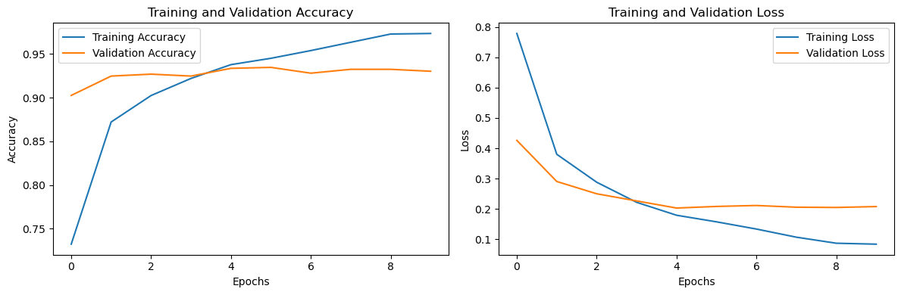
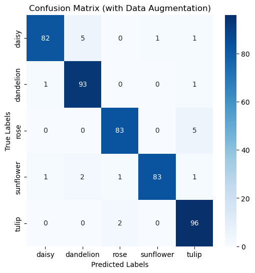
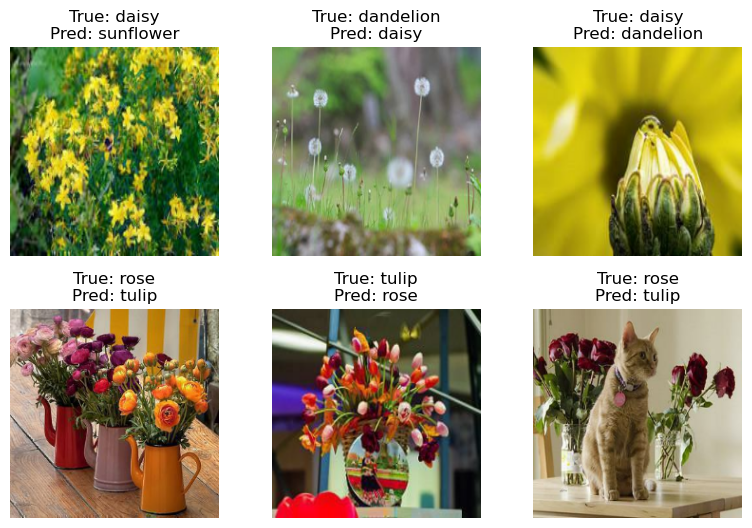
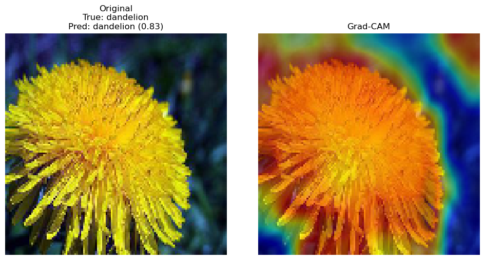
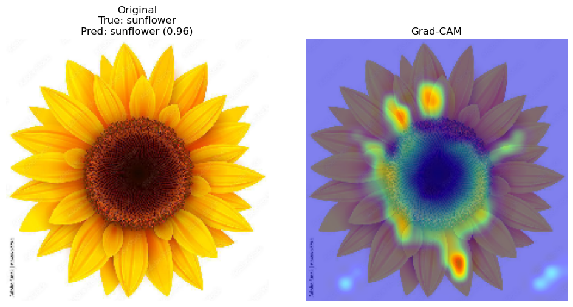
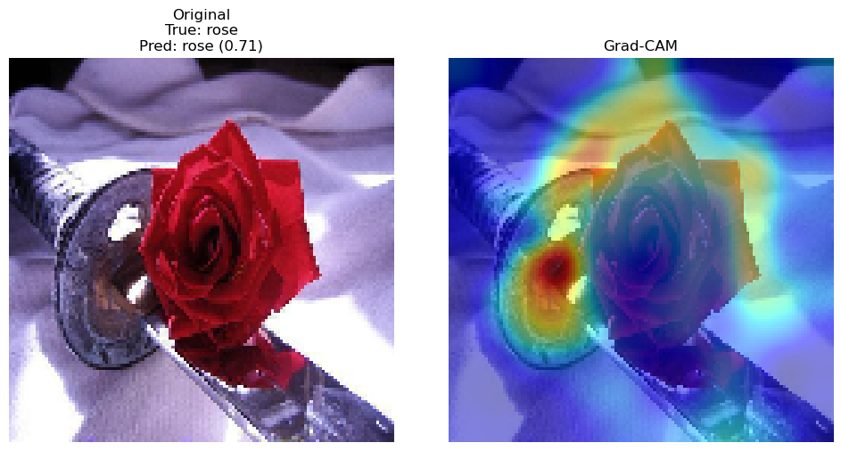

# Flower Image Classification with Deep Learning

A project from my first year of the **Applied Data Science & Artificial Intelligence** bachelor at Breda University of Applied Sciences (2024–25, Block C).
I built my own image dataset of five flower types and trained a deep learning classifier for it. I started from simple baselines and improved the model over four iterations, ending with transfer learning on EfficientNetB0. I then analysed the model's mistakes and used Grad-CAM to see what it looks at.

## Project

- [**Flower classifier**](notebooks/01_flower_classifier.ipynb) covers dataset creation and cleaning, the baselines, four CNN iterations and the error analysis.
- [**Explainability with Grad-CAM**](notebooks/02_explainability_gradcam.ipynb) uses heatmaps to show which parts of an image drive the final model's predictions.

**Methods & tools:** TensorFlow / Keras, CNNs, data augmentation, transfer learning (MobileNetV2, EfficientNetB0), early stopping and learning-rate scheduling, scikit-learn metrics, Grad-CAM (xplique), OpenCV, imagehash, matplotlib, seaborn

## Dataset

I collected the images myself from [Pexels](https://www.pexels.com/search/flowers/), [Unsplash](https://unsplash.com/s/photos/flower) and [Pixabay](https://pixabay.com/images/search/flowers/). The dataset has five classes: **daisy, dandelion, rose, sunflower and tulip**.

- **Cleaning:** I removed files that were not valid JPEGs and removed duplicate images using perceptual hashing (`imagehash`).
- **Size:** 4,528 images, fairly balanced (between 872 and 968 per class).
- **Split:** 70 / 20 / 10, giving **3,167 train**, **903 validation** and **458 test** images.

## Results

Test-set results for each step, with weighted precision, recall and F1:

| Model | Accuracy | Precision | Recall | F1 |
|-------|---------:|----------:|-------:|---:|
| Random guess | 20.0% | – | – | – |
| Multilayer perceptron (baseline) | 44.3% | – | – | – |
| Basic CNN (iteration 1) | 73.4% | 0.74 | 0.73 | 0.73 |
| CNN + data augmentation (iteration 2) | 67.5% | 0.69 | 0.67 | 0.67 |
| MobileNetV2, transfer learning (iteration 3) | 89.5% | 0.90 | 0.90 | 0.90 |
| **EfficientNetB0, improved (iteration 4)** | **95.4%** | **0.96** | **0.95** | **0.95** |
| *Human baseline (3 people, 50 images)* | *92%* | | | |

The final model is a frozen EfficientNetB0 (pre-trained on ImageNet) with a small dense head (batch normalisation and dropout). It was trained with early stopping and `ReduceLROnPlateau`. It beats the human baseline on this test set.

Data augmentation on its own made the from-scratch CNN *worse*. Transfer learning gave by far the biggest improvement.

<p align="center">
  
</p>
<p align="center">
  
</p>

## Error analysis

The final model misclassified 21 of the 458 test images. Most of the mistakes fall into a few groups:

- **Similar-looking flowers:** daisy, dandelion and sunflower are often yellow and round, so the model mixes them up.
- **Roses vs. tulips:** roses were most often predicted as tulips, especially in bouquets and vases.
- **Busy backgrounds, cropped flowers and low image quality** account for most of the remaining errors.

<p align="center">
  
</p>

Proposed improvements include more varied rose images, cropping and centring the flowers, and fine-tuning the top layers of the pre-trained model.

## Explainability (Grad-CAM)

Grad-CAM heatmaps show where the model looks. For the dandelion, the model focuses on the whole flower head. For the sunflower, it focuses on the petal edges around the centre. The rose example is the interesting one: the prediction is correct, but the heatmap is centred on the sword guard next to the rose rather than on the flower itself. A correct prediction is not always made for the right reason.

| Dandelion | Sunflower | Rose |
|:---:|:---:|:---:|
|  |  |  |

## Repository structure

```
.
├── notebooks/
│   ├── 01_flower_classifier.ipynb        # Dataset, baselines, 4 model iterations, error analysis
│   └── 02_explainability_gradcam.ipynb   # Grad-CAM on the final model
├── images/                               # Figures used in this README
└── requirements.txt
```

## How to run

Use Python 3.10 or 3.11. TensorFlow 2.15 does not support newer versions, and the cleaning step uses `imghdr`, which was removed in Python 3.13.

```bash
git clone <this-repo-url>
cd flower-image-classifier
python -m venv .venv
# Windows: .venv\Scripts\activate   |   macOS/Linux: source .venv/bin/activate
pip install -r requirements.txt
jupyter lab
```

Both notebooks are saved with their outputs, so you can read them on GitHub without running anything.

> The image dataset and the trained model are not included in this repository because of their size. To re-run the notebooks, place the images in one folder per class under `data/flowers_raw/`. Notebook 01 splits them into `data/flowers/{train,val,test}/`. Notebook 02 expects the trained model in `models/flower_classifier/`.
